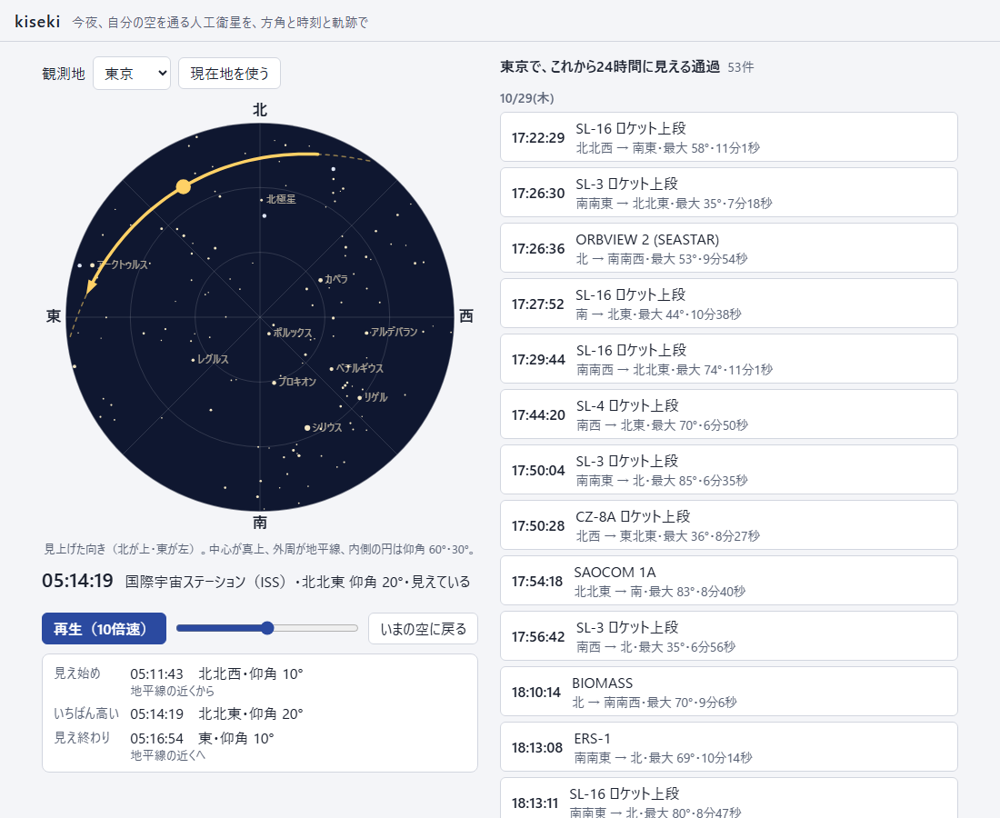
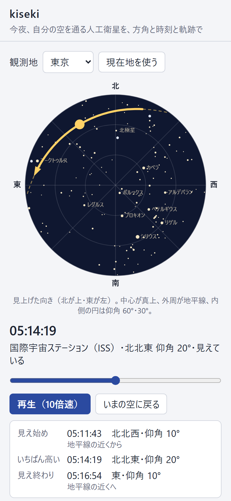

# kiseki

今夜、自分の空を通る人工衛星を、何時にどの方角から現れて、どこへ消えるかで示す。
国際宇宙ステーション（ISS）・中国の宇宙ステーション 天宮と、CelesTrak の「明るい衛星」の一覧（約150機）が対象。

**アプリ:** https://tame0522works-art.github.io/kiseki/ （PC・スマホのブラウザで、開くだけで使える。軌道要素は毎日 15 時に入れ替わる）



衛星の位置は SGP4 を自分で書いて計算し、論文付録の検証用データと JAXA の予報で答え合わせした。
計算はすべて端末の中で行い、公開版は Content Security Policy で通信（fetch など）をすべて禁じている。

## できること



- **これから24時間の見える通過を一覧にする**: 見え始めの時刻、どの方角からどの方角へ、最大仰角、見えている長さ。宇宙ステーションは左に太い線を付けて目立たせる
- **低い通過は初めは隠す**: 最大仰角 30° 未満は建物や山に隠れやすいので、切り替えで出す（宇宙ステーションは低くても出す）
- **選んだ通過を全天図に描く**: 見えている区間は太い実線、地球の影の中や仰角 10° 未満は破線。進む向きに矢印
- **時刻のつまみと再生（10倍速）**: 5分ほどの通過が30秒で流れる。いまの位置が「見えている」「地球の影の中」「地平線の下」のどれかを添える
- **見え始め・見え終わりの理由**: 「地球の影から出て、空の途中で現れる」「地球の影に入り、空の途中で消える」など。衛星が空の途中で急に消えるのは影に入るため
- **星を目印に**: 3.5 等より明るい285星と、シリウス・ベガなど17星の名前。空の明るさに合わせて、夜はすべて、薄明は1等星だけ、昼は描かない
- **観測地**: 10都市から選ぶか、端末の現在地。現在地は小数第2位（約1km）に丸めて、この端末の中だけで使う。選んだ観測地は次に開いたときも残る

<br clear="right">

## 作りの要点

### 衛星の位置: SGP4 を自分で書いた

[`src/sat/sgp4.ts`](src/sat/sgp4.ts)。軌道要素（TLE／OMM）から位置を出す標準の方法 SGP4 を、Vallado ほか "Revisiting Spacetrack Report #3"（AIAA 2006-6753）の改良版に沿って書いた。

- **近地球（周期 225 分未満）だけ。** 肉眼で見える衛星はほぼ低軌道で、CelesTrak の明るい衛星の一覧にも深宇宙の軌道は無かった
- 地球の定数は WGS-72。TLE はこの定数で作られているので、WGS-84 にすると合わなくなる
- 論文付録の検証用 TLE と期待値（Fortran 版の出力）で照合し、近地球の9機・158時刻で**位置の差は 0.01mm 未満**（`check:sgp4`）。途中で落下する4機は、期待値が止まる時刻でこちらも誤りになることを確かめた。J4 の値をわずかにずらすと照合が落ちることも確かめ、照合が働いていることを見た

### 見えるかどうか

[`src/sat/passes.ts`](src/sat/passes.ts)。次の3つがそろったときに「見える」とする。

| 条件 | 計算 |
|---|---|
| 空が暗い | 観測地の太陽高度が −6° 以下（市民薄明の終わり）。太陽の位置は [hikage](https://github.com/tame0522works-art/hikage) の Meeus の式を流用し、国立天文台の値と 0.016° 以内（`check:sun`） |
| 衛星に日が当たっている | 地球を球、影を太陽と反対へ伸びる円柱とみなす（円柱モデル）。本影と半影は分けない |
| 衛星が十分に高い | 仰角 10° 以上 |

1分刻みで条件の変わり目を探し、変わり目は二分法で1秒まで詰める。いちばん高い時刻は黄金分割探索で求める。
衛星約150機・24時間の探索はパソコンで 0.3 秒ほどで、スマホでは数倍かかるので Web Worker で計算する。

### 答え合わせ: JAXA の予報

JAXA の支援で運営されている [#きぼうを見よう](https://lookup.kibo.space/) の東京の予報（2026年10月29日に見たもの、3週間分の15通過）と比べた（`check:jaxa`）。

- **15通過すべてが見つかり、見え始めの時刻の差は最大27秒**。JAXA は見え始めを30秒単位で切り上げて出しているので、その幅に収まっている
- こちらにだけある通過が4件あった。3件は見えている時間が80秒未満の短い通過、1件は日没直後で空がまだ明るい時間の通過。JAXA は見える長さや空の暗さを、こちらより厳しく見ているとみられる
- 照合に使った ISS の軌道要素は、予報を見た日のものを [`tools/jaxa-reference.json`](tools/jaxa-reference.json) に固定している。軌道要素が毎日変わっても、照合は同じ結果になる

### 全天図

[`src/ui/sky.ts`](src/ui/sky.ts)。真上が中心、地平線が外周で、星座早見と同じく見上げた向き（北が上・東が左）にした。
中心からの距離は天頂角に比例させた（正距方位図法）ので、仰角 30°・60° の円が等間隔に並ぶ。空の色は太陽高度で昼・薄明・夜の3段階。

星はイェール輝星星表 第5版（BSC5）の J2000.0 の座標を、歳差（Meeus 21章の厳密な式）でその日の座標に直して描く。
歳差は Meeus の例 21.b と 0.00001° 以内で一致し、北極星の高度は観測地の緯度と 0.62° 以内（北極星は天の北極から 0.7° ほど離れている）（`check:stars`）。
固有運動は入れていない。いちばん速いアークトゥルスでも、2000年から30年で 0.02° ほどしか動かない。

### 軌道要素は毎日入れ替える

軌道要素は日がたつと精度が落ちる（ISS は軌道を上げるための噴射もする）。
GitHub Actions が毎日 15:00（日本時間）に CelesTrak から取り直し、照合・画面操作のテストを通ったものだけを公開する。取った時刻は画面の下に出し、3日より古ければ時刻が数分ずれうると知らせる。
CelesTrak の更新は約2時間ごとなので、手元で取り直すときも2時間以内のファイルがあれば取らない。

## 確かめ方

| コマンド | 確かめること |
|---|---|
| `npm run check:sgp4` | Vallado の検証用 TLE で、位置・速度が期待値と一致する（上記） |
| `npm run check:sun` | 太陽の高度・方位が国立天文台の値と 0.02° 以内 |
| `npm run check:stars` | 歳差が Meeus の例と一致、北極星の高度が緯度とほぼ同じ、同梱した星の名前と並び |
| `npm run check:jaxa` | ISS の通過が JAXA の東京の予報15件と一致する（上記） |
| `npm run e2e` | 公開と同じビルドを画面なしの Chrome で開き、本物のクリックで操作する（8件）。通過を選ぶと軌跡が描かれること、再生が10倍速で進み最後で止まること、観測地の保存、壊れた保存データ、低い通過の切り替え、現在地（許可・不許可）、スマホの配置、CSP で通信が止まること |

軌道要素は毎日入れ替わるので、e2e は特定の通過に頼らない（東京で24時間に最大仰角 30° 以上の通過が1件も無いことは、まず起きない）。

## 扱っていないこと

- **衛星の明るさ（等級）。** まだ入れていない。等級の元になる値（衛星ごとの標準等級）は、出典と利用条件を確かめてから入れる。一覧の大半はロケットの上段で、ISS よりずっと暗いものも混じる
- 惑星と月。全天図の目印は恒星だけ
- 周期 225 分以上の深宇宙の衛星（上に書いたとおり）
- 大気差。衛星も星も幾何学的な仰角で描いている（地平線の近くで最大 0.5° ほど低く見える）
- 時刻は日本時間で出す。観測地の候補は国内だけで、現在地も国内を想定している

## データの出典

- 軌道要素: [CelesTrak](https://celestrak.org/)（GP の visual と stations の群）
- 恒星: Hoffleit, D. & Warren, W. H. Jr., *The Bright Star Catalogue, 5th Revised Ed.*（1991）。[SAO Telescope Data Center](http://tdc-www.harvard.edu/catalogs/bsc5.html) の配布ファイルから作った（同梱は [`src/ui/stars.json`](src/ui/stars.json)）。配布元の HTTPS は証明書のホスト名が合わないため HTTP で取り、よく知られた星の座標・等級と Bayer 名で中身を確かめた
- SGP4 の検証用データ: Vallado, D. A. ほか, *Revisiting Spacetrack Report #3*, AIAA 2006-6753 の付録（CelesTrak で配布）
- 照合に使った予報: [#きぼうを見よう](https://lookup.kibo.space/)（KIBO宇宙放送局 運営、JAXA 支援）

## 開発

```bash
npm install
npm run fetch     # SGP4 の検証用データと CelesTrak の軌道要素を raw/ に取る（raw/ は git に入れない）
npm run convert   # raw/ から src/data/satellites.json を作る（毎日変わるので git に入れない）
npm run dev       # http://localhost:5207/
npm run check     # check:sgp4・check:sun・check:stars・check:jaxa
npm run e2e       # 画面操作のテスト
npm run build && npm run preview   # 公開版を http://localhost:5208/ で確かめる
npm run screenshots                # 公開版から docs/images/ の画像を撮る
npm run stars     # BSC5 から src/ui/stars.json を作り直す（星表は変わらないので、ふだんは要らない）
```
